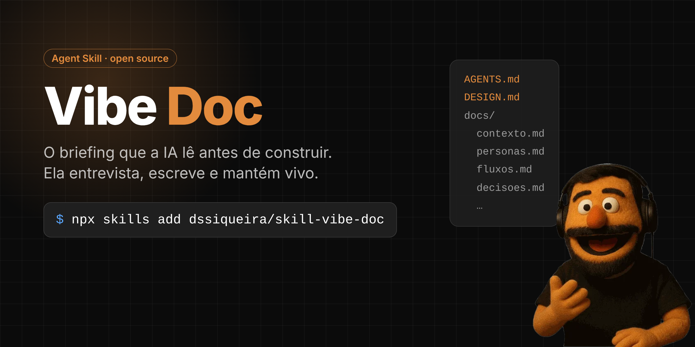

<p align="center">
  
</p>

<p align="center">
  <a href="LICENSE"></a>
  
  <a href="https://agentskills.io"></a>
  <a href="https://github.com/google-labs-code/design.md"></a>
  
</p>

<p align="center">
  <b>Você abre a IA com uma ideia. Ela constrói outra coisa.</b><br>
  O problema não é a IA. É o briefing.
</p>

---

Um PRD é para um dev que faz perguntas. Um **Vibe Doc** é para uma IA que assume. Esta skill faz a IA assumir certo: **entrevista você, escreve o briefing do seu produto e mantém tudo atualizado enquanto o código anda.**

## Em 30 segundos

```bash
npx skills add dssiqueira/skill-vibe-doc
```

Abra o seu projeto no agente e peça:

```
Cria o Vibe Doc desse projeto
```

Ela faz as perguntas que você não tinha pensado, em blocos curtos, e entrega:

```
seu-projeto/
├── AGENTS.md              porta de entrada que qualquer agente lê primeiro
├── DESIGN.md              a cara do produto, no padrão aberto do Google
└── docs/
    ├── contexto.md        problema, escopo, o que não é, critério de sucesso e de morte
    ├── personas.md        quem usa, em que situação, o que evita
    ├── estruturadedados.md  entidades, campos e regras de negócio
    ├── fluxos.md          telas, fluxos e estados
    ├── metricas.md        o que medir e quais eventos registrar
    ├── integracoes.md     autenticação, banco, APIs, infraestrutura
    └── decisoes.md        decisões técnicas com alternativa descartada e motivo
```

## Antes e depois

| Sem Vibe Doc | Com Vibe Doc |
|---|---|
| "Cria um app para personal trainer" | A IA já sabe que o Carlos usa o celular com uma mão, entre um aluno e outro |
| A IA chuta a cor, a fonte e o espaçamento a cada tela | Todo elemento visual sai do DESIGN.md, igual em todas as telas |
| Cada sessão reabre a discussão sobre o banco | A decisão está no `decisoes.md`, com o motivo |
| O doc envelhece na primeira semana | A skill atualiza só o que mudou, sempre que você pede |
| Ninguém sabe quando parar | Critério de sucesso e de morte definidos antes de construir |

## Os quatro modos

| Peça assim | O que ela faz |
|---|---|
| *"Cria o Vibe Doc desse projeto"* | Entrevista em blocos de até 3 perguntas, gera todos os arquivos e roda uma conferência de consistência |
| *"Atualiza o Vibe Doc com o que mudei hoje"* | Lê o diff, mapeia cada mudança para o arquivo certo e mexe só nele |
| *"Revisa o Vibe Doc"* | Lista contradições, docs atrás do código e trechos vagos, do mais grave ao menos |
| *"Migra meu Vibe Doc antigo"* | Separa o `layout.md` em `fluxos.md` (telas) e `DESIGN.md` (visual) |

E quando o próprio agente acaba de mudar algo relevante no código, ela atualiza os docs antes de encerrar, sem esperar pedido.

## Instalar

**Skills CLI** (Claude Code, Codex, Cursor e outras ferramentas compatíveis com o padrão aberto de [Agent Skills](https://agentskills.io)):

```bash
npx skills add dssiqueira/skill-vibe-doc          # no projeto
npx skills add dssiqueira/skill-vibe-doc -g       # para todos os projetos
```

**Claude Code, na mão:**

```bash
git clone https://github.com/dssiqueira/skill-vibe-doc
cp -r skill-vibe-doc/skills/vibe-doc ~/.claude/skills/
```

**App do Claude:** baixe o [.zip da skill](https://doug.ia.br/downloads/vibe-doc-skill.zip) e envie na área de Skills das configurações.

## DESIGN.md: a cara do produto em um arquivo

O [DESIGN.md](https://github.com/google-labs-code/design.md) é o padrão aberto do Google Labs para identidade visual: tokens em YAML que a máquina aplica e seções em markdown com o porquê. A skill monta o seu a partir das suas referências, ou propõe um a partir das personas.

```yaml
---
name: Treinou
colors:
  primary: "#0B7A3E"
  on-primary: "#FFFFFF"
typography:
  body-md:
    fontFamily: Inter
    fontSize: 16px
components:
  button-primary:
    backgroundColor: "{colors.primary}"
    textColor: "{colors.on-primary}"
    height: 48px
---
```

Valide e leve para o código:

```bash
npx @google/design.md lint DESIGN.md                          # estrutura, referências e contraste
npx @google/design.md export --format css-tailwind DESIGN.md  # tema pronto para Tailwind
```

Quer travar isso no CI? Um passo no GitHub Actions resolve:

```yaml
- name: Lint do DESIGN.md
  run: npx -y @google/design.md lint DESIGN.md
```

## Exemplos

Cinco Vibe Docs completos, todos com DESIGN.md passando no lint oficial sem erro nem aviso:

| Exemplo | Produto | O que ele mostra |
|---|---|---|
| [`01-app-b2c-personal-trainer`](exemplos/01-app-b2c-personal-trainer) | **Treinou**, app mobile para personal trainers | Mobile-first radical, offline, registro em um toque |
| [`02-saas-b2b-interno`](exemplos/02-saas-b2b-interno) | **Balcão TI**, chamados internos | Dois perfis com necessidades opostas, SSO, hospedagem interna |
| [`03-marketplace`](exemplos/03-marketplace) | **Resolve Aí**, serviços locais | Dois lados, confiança, acessibilidade para quem lê sem óculos |
| [`04-ferramenta-automacao`](exemplos/04-ferramenta-automacao) | **Embarque**, onboarding de clientes | Automação sem IA nenhuma, e o porquê de cada etapa |
| [`05-criacao-de-lps`](exemplos/05-criacao-de-lps) | **Página Pronta**, landing pages com IA | IA com guardrail, custo por geração e DESIGN.md do cliente como entrada |

## Sem agente?

Os esqueletos estão em [`skills/vibe-doc/templates`](skills/vibe-doc/templates). Copie para o seu projeto e preencha seguindo o guia de [`references/arquivos.md`](skills/vibe-doc/references/arquivos.md).

## Por dentro da skill

```
skills/vibe-doc/
├── SKILL.md              os modos, a conferência e as regras
├── references/
│   ├── arquivos.md       o que vai em cada arquivo e as regras de escrita
│   ├── entrevista.md     o roteiro de perguntas do modo criar
│   ├── design-md.md      o formato do DESIGN.md, com exemplo e comandos
│   └── manutencao.md     mapa de mudança para arquivo e critérios de revisão
├── templates/            esqueletos de todos os arquivos
└── exemplo/              um Vibe Doc completo de referência
```

## Perguntas frequentes

**Funciona fora do Claude?**
Sim. A skill segue o padrão aberto de Agent Skills. E o resultado é markdown puro com um AGENTS.md na raiz, que qualquer ferramenta lê.

**Já tenho CLAUDE.md, .cursorrules e afins. E agora?**
No modo migrar, a skill reduz cada um a uma linha que aponta para o AGENTS.md. No Claude Code, um `CLAUDE.md` com `@AGENTS.md` basta.

**Em que idioma ela escreve?**
No seu. Os nomes dos arquivos ficam como estão.

**E o create-vibedoc (o CLI)?**
Continua existindo para quem quer só o esqueleto, sem agente. A skill é o caminho recomendado a partir da versão 3.

## Contribuir

Achou um jeito melhor de perguntar, um exemplo que falta ou uma regra que a IA ignora? Abra uma issue ou um pull request. Exemplos novos são muito bem-vindos: siga a estrutura de `exemplos/` e rode o lint do DESIGN.md antes.

## Autor

Feito por [Douglas Siqueira](https://doug.ia.br), que usa o Vibe Doc para construir produto com IA num laboratório de IA e automação de verdade.

- Página do método: [doug.ia.br/vibedoc](https://doug.ia.br/vibedoc)
- Handbook *Vibe Coding na Prática*: [doug.ia.br/handbooks/vibe-coding-pm-builder](https://doug.ia.br/handbooks/vibe-coding-pm-builder)
- Newsletter: [Doug Drops](https://doug.ia.br/dougdrops)

Licença [MIT](LICENSE). Use, adapte e compartilhe.
